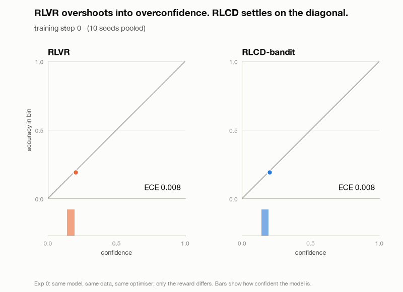
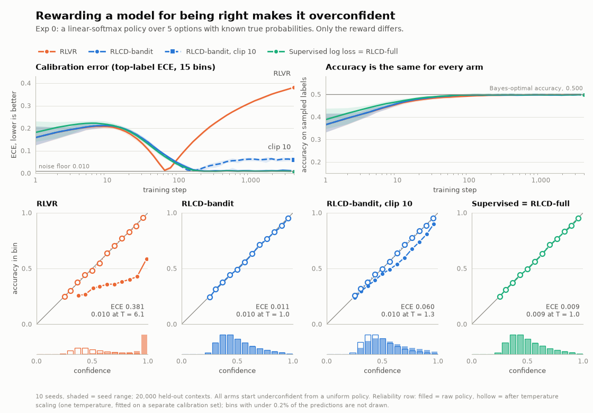
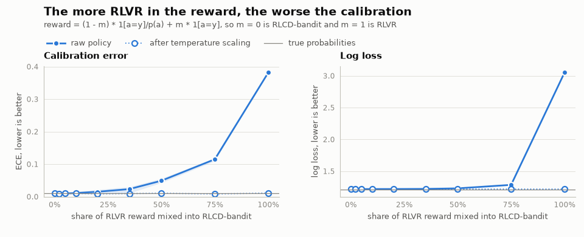
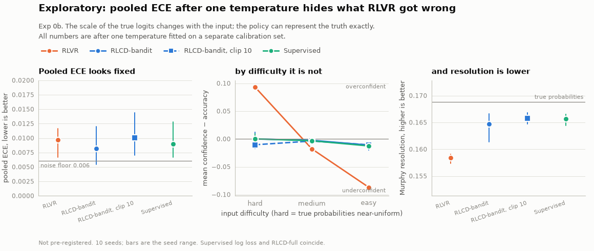
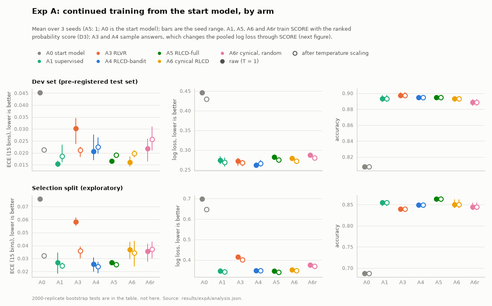
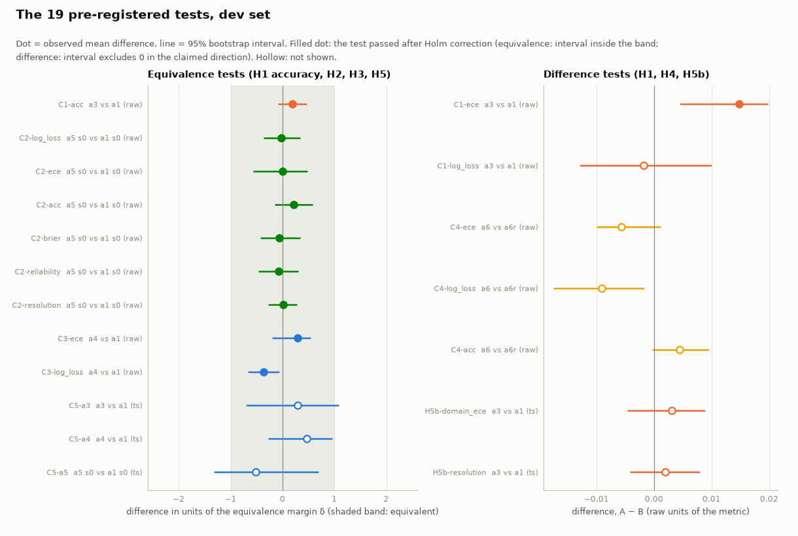
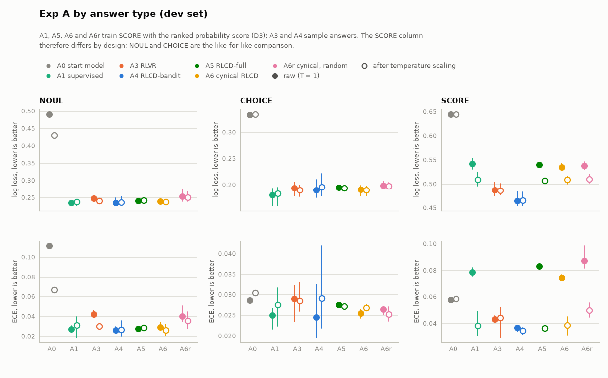
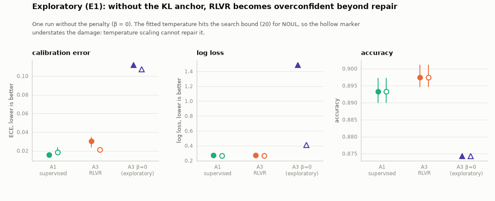

# open-rlcd

**RLCD, reverse-engineered: why rewarding a model for being right makes it overconfident, and the one-line fix.**

> **This repo presents one reading of RLCD, not TypeSafe's method.** TypeSafe has not published RLCD. What
> follows is an open, pre-registered attempt to test whether the idea, as described, works, with the results
> that go against it reported too.
> *Name collision:* "RLCD" is also the name of Reinforcement Learning from Contrastive Distillation
> (Yang et al., [arXiv:2307.12950](https://arxiv.org/abs/2307.12950)), an unrelated method.

[](https://github.com/Louiskq/open-rlcd/actions/workflows/ci.yml)
[](LICENSE)
[](https://colab.research.google.com/github/Louiskq/open-rlcd/blob/main/notebooks/toy_rlcd.ipynb)

<p align="center">
  <picture>
    <source media="(prefers-color-scheme: dark)" srcset="figures/toy_hero-dark.gif">
    
  </picture>
</p>
<p align="center"><sub>Same model, same data, same optimiser. Only the reward differs. (Exp 0: a toy where the true probabilities are known.)</sub></p>

> **Status: Exp A is run and analysed; Exp B is in progress.** The pre-registration was frozen before the Exp A runs
> ([`PREREGISTRATION.md`](PREREGISTRATION.md)); its two amendments are dated. Exp A (the 9B decider with teacher labels)
> gave a **mixed** result that does not simply confirm RLCD: see [Exp A results](#exp-a-results-a-9b-decider-with-teacher-labels).
> Rows for Exp B say *pending* until it has run. See [Status](#status).

## TL;DR

- **The idea.** Reward the model with a *proper scoring rule* applied to the distribution it states over typed
  options, instead of rewarding it for being right.
- **The one-line fix.** When only the sampled answer `a` can be checked, use reward `1[a=y] / p(a)` (no
  gradient through the denominator) instead of `1[a=y]`. That makes REINFORCE an unbiased estimator of the
  log-likelihood gradient, so calibration is recoverable from bandit feedback.
- **What is shown.** In the toy, the 0/1 reward makes the model more confident than accurate while leaving
  accuracy unchanged and the importance-weighted reward does not. In the 9B model with a KL anchor the effect is
  much smaller, and the pre-registered sceptical reading (a proper-loss fine-tune plus temperature scaling matches the
  RL arms) is largely borne out; see below.

<!-- BEGIN gen:tldr -->
| setting | arm | ECE (lower is better) | accuracy | log loss |
|---|---|---|---|---|
| Exp 0 (toy) | RLVR | [0.381 (0.380–0.382)](results/toy/rlvr.json) | [0.499 (0.498–0.500)](results/toy/rlvr.json) | [3.047 (3.037–3.057)](results/toy/rlvr.json) |
| Exp 0 (toy) | RLCD-bandit | **[0.011 (0.008–0.014)](results/toy/rlcd_bandit.json)** | [0.498 (0.496–0.501)](results/toy/rlcd_bandit.json) | [1.221 (1.219–1.225)](results/toy/rlcd_bandit.json) |
| Exp 0 (toy) | RLCD-bandit, clip 10 | [0.060 (0.056–0.066)](results/toy/rlcd_bandit_clip10.json) | [0.499 (0.496–0.502)](results/toy/rlcd_bandit_clip10.json) | [1.241 (1.238–1.244)](results/toy/rlcd_bandit_clip10.json) |
| Exp 0 (toy) | Supervised log loss (= RLCD-full) | **[0.009 (0.006–0.012)](results/toy/supervised.json)** | [0.498 (0.495–0.500)](results/toy/supervised.json) | [1.220 (1.218–1.222)](results/toy/supervised.json) |
| Exp A (9B decider, dev set) | A0 start model | [0.045](results/expA/analysis.json) | [0.808](results/expA/analysis.json) | [0.446](results/expA/analysis.json) |
| Exp A (9B decider, dev set) | A1 supervised | **[0.015 (0.014–0.017)](results/expA/analysis.json)** | [0.893 (0.890–0.897)](results/expA/analysis.json) | [0.274 (0.265–0.283)](results/expA/analysis.json) |
| Exp A (9B decider, dev set) | A3 RLVR | [0.030 (0.024–0.034)](results/expA/analysis.json) | [0.897 (0.895–0.901)](results/expA/analysis.json) | [0.273 (0.261–0.279)](results/expA/analysis.json) |
| Exp A (9B decider, dev set) | A4 RLCD-bandit | [0.021 (0.017–0.028)](results/expA/analysis.json) | [0.895 (0.893–0.896)](results/expA/analysis.json) | [0.262 (0.257–0.268)](results/expA/analysis.json) |
| Exp A (9B decider, dev set) | A5 RLCD-full | **[0.017](results/expA/analysis.json)** | [0.895](results/expA/analysis.json) | [0.282](results/expA/analysis.json) |
| Exp A (9B decider, dev set) | A6 mined | **[0.016 (0.014–0.018)](results/expA/analysis.json)** | [0.893 (0.890–0.896)](results/expA/analysis.json) | [0.279 (0.276–0.282)](results/expA/analysis.json) |
| Exp A (9B decider, dev set) | A6r random | [0.022 (0.017–0.026)](results/expA/analysis.json) | [0.889 (0.885–0.893)](results/expA/analysis.json) | [0.288 (0.286–0.291)](results/expA/analysis.json) |
| Exp B (Breakout, on-policy) | B1–B5 | _pending_ | _pending_ | _pending_ |
<!-- END gen:tldr -->

<sub>Seed mean (min–max). Bold: best, or within the best arm's seed range. Every number links to the JSON it
came from. Rows marked *pending* have not been run.</sub>

## What is RLCD?

RLCD is reinforcement learning whose reward is a **proper scoring rule applied to the model's stated
distribution over typed options**, judged against an outcome supplied by labels, a verifier, a teacher model or
an environment:

$$
\max_\theta\; \mathbb{E}_{s,\,q,\; y}\Big[\, S\big(p_\theta(\cdot\mid s,q),\, y\big) \Big] \;-\; \beta\,\mathrm{KL}\big(p_{\text{ref}} \,\|\, p_\theta\big)
$$

A question is *typed*: `NOUL` (true or false), `CHOICE` (one of several unordered options) or `SCORE` (an
ordered scale). The model gives a probability for every option in one forward pass. $S$ is the log score for
`NOUL` and `CHOICE`, and the negative ranked probability score (RPS) for `SCORE`. The penalty is the
*forward* KL, the direction decider's retention term uses. It is large when the policy puts little mass on an
option the reference supports, so it penalises collapse onto one option and partly counteracts RLVR's
overconfidence; one exploratory run without it will show by how much ([`docs/decisions.md`](docs/decisions.md) D1).

<p align="center">
  <picture>
    <source media="(prefers-color-scheme: dark)" srcset="figures/concept-dark.png">
    
  </picture>
</p>

**The contrast case is RLVR**, where the reward is $\mathbb{1}[a=y]$ for a sampled answer $a\sim p_\theta$.
Its expected value, $\sum_a p(a)\,q(a)$, is maximised by putting all the probability on the most likely answer.
It is an *improper* score, so it pushes the model to be sharper than the outcomes justify.

**Bandit form.** Sometimes only the sampled answer can be checked. With reward
$r = \mathbb{1}[a=y]/p_\theta(a)$ (stop-gradient on the denominator), REINFORCE is an unbiased estimator of
$\nabla\log p_\theta(y)$:

$$
\mathbb{E}_{a\sim p}\Big[\tfrac{\mathbb{1}[a=y]}{p(a)}\,\nabla\log p(a)\Big] \;=\; \sum_a p(a)\,\tfrac{\mathbb{1}[a=y]}{p(a)}\,\nabla\log p(a) \;=\; \nabla\log p(y).
$$

[`tests/test_estimators.py`](tests/test_estimators.py) checks this by exact enumeration, by Monte Carlo, and by
showing the same check *rejects* RLVR. Clipping the weight trades that unbiasedness for lower variance; the
tests pin the bias exactly (`min(1, c·p_y)` times the true gradient).

**When is RL needed at all?** With fixed labels, the full-distribution RLCD objective has the same gradient as
supervised log loss. RL is necessary only when (a) feedback is bandit-only, or (b) outcomes depend on the
model's own actions (on-policy environments). The experiments are built around that claim: Exp A tests the
label setting, Exp B the on-policy one.

## Is RLCD just a data engine?

A sceptic can read RLCD as a **branded proper-scoring fine-tune, with at most a data loop around it, and no RL in
it**. This repo tests that reading in three places instead of arguing about it:

- **The main test, Exp A: A2 against the RL arms.** A2 is "train normally, calibrate afterwards": continue the start
  model with plain log loss (RPS for `SCORE`), then fit one temperature per answer type. If the cynical reading is
  right, A2 should match the RL arms (A3 RLVR, A4 RLCD-bandit, A5 RLCD-full) once those are temperature-scaled too.
  That is pre-registered hypothesis **H5**, with **H5b** checking the per-domain calibration and resolution that
  pooled ECE can hide (Exp 0b).
- **Does mining add anything? A6 against A6r.** No new data is generated. The training pool is split in half by
  hash. **A6** starts on half A and, over four rounds, mines the questions the current model is least sure about
  from half B (labels stay hidden until after selection), fine-tuning with plain log loss; **A6r** selects from the
  same half B at random with the same per-type quotas. Both get the same total optimiser steps as every other arm
  (a quarter per round, continuing from the previous round's weights). Because both only choose among data already
  in the pool, A6 against A6r tests the *selection rule*, not data volume (**H4**).
- **Exp B, B4 ("cynical")**: take B1's final policy, fit the belief heads by supervised log loss on that
  policy's rollouts, then temperature-scale. B3 trains the beliefs jointly and on-policy (**H7**).

**Result for Exp A** (details [below](#exp-a-results-a-9b-decider-with-teacher-labels)): on the pre-registered dev set, the
supervised control plus temperature scaling is within noise of the RL arms, and A6 is not shown to beat A6r after the
pre-registered correction. The equivalence the hypothesis asked for (H5) was **not established** at the pre-registered
margin, and mining's small advantage on log loss did not survive Holm correction. **Exp B (H7) is pending.** The Exp B result
will be reported here with the same prominence whichever way it goes.

## Try it

| | |
|---|---|
| **Colab notebook**, runs the toy on a CPU and has a slider that mixes the two rewards | [](https://colab.research.google.com/github/Louiskq/open-rlcd/blob/main/notebooks/toy_rlcd.ipynb) |
| **`make toy`**, the same experiment as a script; regenerates `results/toy/` and `figures/` | available |
| **`python -m rlcd.demo --state "..." --question "..."`**, a typed answer with a probability per option from the released model | *pending* (needs the phase 3 model release) |
| **Interactive reliability-diagram explorer** (arm × answer type × temperature scaling on/off) | *pending* (needs Exp A predictions) |

## Exp 0 results: a toy where the truth is known

<!-- BEGIN gen:toy_setup -->
10 seeds × 4,000 Adam steps per arm, evaluated on 20,000 held-out contexts. The true probabilities themselves score ECE [0.010](results/toy/meta.json) on this sample (the noise floor) and the Bayes-optimal accuracy is [0.500](results/toy/meta.json).
<!-- END gen:toy_setup -->

A linear-softmax policy over 5 options, labels drawn from a fixed ground-truth softmax, so the policy class
contains the truth and "calibrated" has an exact meaning. Every arm has the same model, optimiser, learning rate
and data stream per seed; only the reward differs.

<p align="center">
  <picture>
    <source media="(prefers-color-scheme: dark)" srcset="figures/toy_overview-dark.png">
    
  </picture>
</p>

<!-- BEGIN gen:toy_table -->
| arm | ECE | accuracy | log loss | KL(truth ‖ model) | ECE after temperature scaling |
|---|---|---|---|---|---|
| RLVR | [0.381 (0.380–0.382)](results/toy/rlvr.json) | [0.499 (0.498–0.500)](results/toy/rlvr.json) | [3.047 (3.037–3.057)](results/toy/rlvr.json) | [1.837 (1.827–1.846)](results/toy/rlvr.json) | **[0.010 (0.008–0.012)](results/toy/rlvr.json) (T = 6.1)** |
| RLCD-bandit | **[0.011 (0.008–0.014)](results/toy/rlcd_bandit.json)** | [0.498 (0.496–0.501)](results/toy/rlcd_bandit.json) | **[1.221 (1.219–1.225)](results/toy/rlcd_bandit.json)** | **[0.006 (0.004–0.010)](results/toy/rlcd_bandit.json)** | **[0.010 (0.008–0.013)](results/toy/rlcd_bandit.json) (T = 1.0)** |
| RLCD-bandit, clip 10 | [0.060 (0.056–0.066)](results/toy/rlcd_bandit_clip10.json) | [0.499 (0.496–0.502)](results/toy/rlcd_bandit_clip10.json) | [1.241 (1.238–1.244)](results/toy/rlcd_bandit_clip10.json) | [0.026 (0.022–0.029)](results/toy/rlcd_bandit_clip10.json) | **[0.010 (0.009–0.012)](results/toy/rlcd_bandit_clip10.json) (T = 1.3)** |
| Supervised log loss | **[0.009 (0.006–0.012)](results/toy/supervised.json)** | [0.498 (0.495–0.500)](results/toy/supervised.json) | **[1.220 (1.218–1.222)](results/toy/supervised.json)** | **[0.004 (0.003–0.007)](results/toy/supervised.json)** | **[0.009 (0.005–0.012)](results/toy/supervised.json) (T = 1.0)** |
| RLCD-full | **[0.009 (0.006–0.012)](results/toy/rlcd_full.json)** | [0.498 (0.495–0.500)](results/toy/rlcd_full.json) | **[1.220 (1.218–1.222)](results/toy/rlcd_full.json)** | **[0.004 (0.003–0.007)](results/toy/rlcd_full.json)** | **[0.009 (0.005–0.012)](results/toy/rlcd_full.json) (T = 1.0)** |
| _the true probabilities_ | [0.010](results/toy/meta.json) | [0.500](results/toy/meta.json) | [1.215](results/toy/meta.json) | 0 | |

Seed mean (min–max). Bold: best, or within the best arm's seed range. Supervised log loss and RLCD-full are the same objective through two code paths; their curves differ by at most [4.4e-16](results/toy/meta.json) over every metric, seed and step.
<!-- END gen:toy_table -->

What the figure and table say:

- **Accuracy does not move.** RLVR is not worse at picking the answer; it is worse at knowing how sure to be.
- **RLVR is overconfident, and its log loss is worse than the uniform guess.** It passes through calibration early
  and keeps sharpening.
- **RLCD-bandit lands on the diagonal using only the sampled answer**, and tracks supervised log loss.
- **Clipping the weight at 10 is measurably biased**: options whose true probability is under 0.1 are
  under-weighted, so the policy ends up too sharp (next table).
- **Supervised log loss and RLCD-full are one curve**: with fixed labels they are the same objective.
- **One temperature repairs RLVR in this toy** (the hollow markers). See the caveats, and Exp 0b below for
  what happens when difficulty varies.

### Why: bias and noise of each gradient estimator at the truth

At the true parameters a proper, unbiased objective has zero expected gradient (calibration is a fixed point).
Measured over many batches, with all arms seeing the same contexts and labels:

<!-- BEGIN gen:toy_noise -->
| arm | bias ‖E[g]‖ | Monte Carlo floor | bias / floor | noise (trace of covariance) |
|---|---|---|---|---|
| RLVR | [0.0435](results/toy/meta.json) | 0.0015 | 29.4× | [0.007](results/toy/meta.json) |
| RLCD-bandit | [0.0062](results/toy/meta.json) | 0.0059 | 1.0× | [0.106](results/toy/meta.json) |
| RLCD-bandit, clip 10 | [0.0250](results/toy/meta.json) | 0.0050 | 5.0× | [0.074](results/toy/meta.json) |
| Supervised log loss | [0.0044](results/toy/meta.json) | 0.0050 | 0.9× | [0.074](results/toy/meta.json) |
| RLCD-full | [0.0044](results/toy/meta.json) | 0.0050 | 0.9× | [0.074](results/toy/meta.json) |
<!-- END gen:toy_noise -->

The importance-weighted reward is unbiased but noisier than supervised log loss. Clipping removes much of that
extra noise at the price of a bias well above the Monte Carlo floor. RLVR has a clearly nonzero gradient at the
truth, which is the formal sense in which it is improper.

### How much RLVR does it take?

`reward = (1 − m)·1[a=y]/p(a) + m·1[a=y]`: `m = 0` is RLCD-bandit, `m = 1` is RLVR.

<p align="center">
  <picture>
    <source media="(prefers-color-scheme: dark)" srcset="figures/toy_mix-dark.png">
    
  </picture>
</p>

<!-- BEGIN gen:toy_mix -->
| share of RLVR in the reward | ECE | ECE after temperature scaling | log loss |
|---|---|---|---|
| 0% | [0.011 (0.010–0.013)](results/toy/mix_sweep.json) | [0.010 (0.009–0.013)](results/toy/mix_sweep.json) | [1.220 (1.219–1.222)](results/toy/mix_sweep.json) |
| 2% | [0.011 (0.010–0.014)](results/toy/mix_sweep.json) | [0.009 (0.008–0.010)](results/toy/mix_sweep.json) | [1.221 (1.220–1.222)](results/toy/mix_sweep.json) |
| 5% | [0.010 (0.008–0.011)](results/toy/mix_sweep.json) | [0.010 (0.009–0.012)](results/toy/mix_sweep.json) | [1.220 (1.219–1.221)](results/toy/mix_sweep.json) |
| 10% | [0.011 (0.009–0.015)](results/toy/mix_sweep.json) | [0.010 (0.008–0.011)](results/toy/mix_sweep.json) | [1.220 (1.219–1.222)](results/toy/mix_sweep.json) |
| 20% | [0.015 (0.008–0.022)](results/toy/mix_sweep.json) | [0.009 (0.006–0.010)](results/toy/mix_sweep.json) | [1.221 (1.220–1.222)](results/toy/mix_sweep.json) |
| 35% | [0.023 (0.011–0.030)](results/toy/mix_sweep.json) | [0.010 (0.007–0.012)](results/toy/mix_sweep.json) | [1.223 (1.222–1.224)](results/toy/mix_sweep.json) |
| 50% | [0.049 (0.043–0.056)](results/toy/mix_sweep.json) | [0.011 (0.009–0.012)](results/toy/mix_sweep.json) | [1.231 (1.228–1.235)](results/toy/mix_sweep.json) |
| 75% | [0.115 (0.110–0.118)](results/toy/mix_sweep.json) | [0.008 (0.007–0.010)](results/toy/mix_sweep.json) | [1.286 (1.281–1.289)](results/toy/mix_sweep.json) |
| 100% | [0.382 (0.381–0.382)](results/toy/mix_sweep.json) | [0.011 (0.011–0.012)](results/toy/mix_sweep.json) | [3.052 (3.049–3.057)](results/toy/mix_sweep.json) |
<!-- END gen:toy_mix -->

The damage grows gradually with the share. It is not a cliff, and a small share is hard to tell from the noise.

### Does the ordering depend on the learning rate?

Final ECE under several learning rates, so the comparison is not an artefact of one setting:

<!-- BEGIN gen:toy_lr -->
3 seeds per cell. Seed mean (min–max).

| arm (final ECE) | lr 0.003 | lr 0.01 | lr 0.03 |
|---|---|---|---|
| RLVR | [0.325 (0.325–0.326)](results/toy/lr_sensitivity.json) | [0.382 (0.381–0.382)](results/toy/lr_sensitivity.json) | [0.421 (0.420–0.423)](results/toy/lr_sensitivity.json) |
| RLCD-bandit | [0.008 (0.008–0.009)](results/toy/lr_sensitivity.json) | [0.011 (0.010–0.013)](results/toy/lr_sensitivity.json) | [0.017 (0.009–0.021)](results/toy/lr_sensitivity.json) |
| RLCD-bandit, clip 10 | [0.056 (0.055–0.058)](results/toy/lr_sensitivity.json) | [0.059 (0.058–0.060)](results/toy/lr_sensitivity.json) | [0.079 (0.069–0.087)](results/toy/lr_sensitivity.json) |
| Supervised log loss | [0.010 (0.008–0.012)](results/toy/lr_sensitivity.json) | [0.009 (0.006–0.012)](results/toy/lr_sensitivity.json) | [0.016 (0.011–0.023)](results/toy/lr_sensitivity.json) |
| RLCD-full | [0.010 (0.008–0.012)](results/toy/lr_sensitivity.json) | [0.009 (0.006–0.012)](results/toy/lr_sensitivity.json) | [0.016 (0.011–0.023)](results/toy/lr_sensitivity.json) |
<!-- END gen:toy_lr -->

## Exp 0b (exploratory, not pre-registered): what if difficulty varies?

In Exp 0 one temperature repairs RLVR, partly because RLVR sharpens every input by about the same factor. Exp 0b
asks what happens when it cannot. The *scale* of the true logits now changes with the input (hard inputs have
near-uniform true probabilities, easy ones near-deterministic ones) while the policy can still represent the truth
exactly, so any miscalibration left after temperature scaling comes from the reward. The scale range was fixed in
the code before the first run and not tuned.

<!-- BEGIN gen:toy0b_setup -->
10 seeds × 4,000 Adam steps per arm, 20,000 held-out contexts, true-logit scale between 0.3 (hard) and 3.0 (easy).
<!-- END gen:toy0b_setup -->

<p align="center">
  <picture>
    <source media="(prefers-color-scheme: dark)" srcset="figures/toy0b-dark.png">
    
  </picture>
</p>

<!-- BEGIN gen:toy0b_table -->
| arm | ECE | ECE after one temperature | resolution after | KL(truth ‖ model) after | confidence − accuracy after, hard / medium / easy |
|---|---|---|---|---|---|
| RLVR | [0.405 (0.403–0.407)](results/toy0b/rlvr.json) | [0.010 (0.007–0.012)](results/toy0b/rlvr.json) (T = 7.2) | [0.158 (0.157–0.159)](results/toy0b/rlvr.json) | [0.030 (0.029–0.031)](results/toy0b/rlvr.json) | [+0.093](results/toy0b/rlvr.json) / [−0.018](results/toy0b/rlvr.json) / [−0.087](results/toy0b/rlvr.json) |
| RLCD-bandit | [0.010 (0.006–0.018)](results/toy0b/rlcd_bandit.json) | [0.008 (0.005–0.012)](results/toy0b/rlcd_bandit.json) (T = 1.0) | [0.165 (0.161–0.167)](results/toy0b/rlcd_bandit.json) | [0.010 (0.007–0.015)](results/toy0b/rlcd_bandit.json) | [−0.000](results/toy0b/rlcd_bandit.json) / [−0.002](results/toy0b/rlcd_bandit.json) / [−0.011](results/toy0b/rlcd_bandit.json) |
| RLCD-bandit, clip 10 | [0.050 (0.042–0.064)](results/toy0b/rlcd_bandit_clip10.json) | [0.010 (0.007–0.014)](results/toy0b/rlcd_bandit_clip10.json) (T = 1.3) | [0.166 (0.165–0.167)](results/toy0b/rlcd_bandit_clip10.json) | [0.007 (0.005–0.008)](results/toy0b/rlcd_bandit_clip10.json) | [−0.010](results/toy0b/rlcd_bandit_clip10.json) / [−0.004](results/toy0b/rlcd_bandit_clip10.json) / [−0.011](results/toy0b/rlcd_bandit_clip10.json) |
| Supervised log loss | [0.009 (0.006–0.015)](results/toy0b/supervised.json) | [0.009 (0.007–0.013)](results/toy0b/supervised.json) (T = 1.0) | [0.166 (0.164–0.167)](results/toy0b/supervised.json) | [0.007 (0.005–0.010)](results/toy0b/supervised.json) | [+0.000](results/toy0b/supervised.json) / [−0.003](results/toy0b/supervised.json) / [−0.013](results/toy0b/supervised.json) |
| RLCD-full | [0.009 (0.006–0.015)](results/toy0b/rlcd_full.json) | [0.009 (0.007–0.013)](results/toy0b/rlcd_full.json) (T = 1.0) | [0.166 (0.164–0.167)](results/toy0b/rlcd_full.json) | [0.007 (0.005–0.010)](results/toy0b/rlcd_full.json) | [+0.000](results/toy0b/rlcd_full.json) / [−0.003](results/toy0b/rlcd_full.json) / [−0.013](results/toy0b/rlcd_full.json) |
| _the true probabilities_ | [0.006](results/toy0b/meta.json) | | [0.169](results/toy0b/meta.json) | 0 | |
<!-- END gen:toy0b_table -->

- **Judged by pooled ECE alone, temperature scaling "fixes" RLVR**: after one temperature every arm is at the noise
  floor.
- **The pooled number hides the problem.** RLVR is still too confident on hard inputs and not confident enough on
  easy ones; averaging the two cancels. The RLCD arms are close to calibrated in every stratum.
- **RLVR also ends with lower resolution and a larger distance to the true probabilities** after temperature
  scaling than the RLCD arms (table above).
- RLVR needs a *different* temperature in each stratum, while the RLCD arms need about the same everywhere:

<!-- BEGIN gen:toy0b_group -->
| arm | temperature per tercile (hard / medium / easy) | ECE after | resolution after | KL(truth ‖ model) after |
|---|---|---|---|---|
| RLVR | 11.5 / 6.7 / 5.3 | [0.007 (0.005–0.009)](results/toy0b/rlvr.json) | [0.166 (0.165–0.167)](results/toy0b/rlvr.json) | [0.009 (0.008–0.009)](results/toy0b/rlvr.json) |
| RLCD-bandit | 1.0 / 1.0 / 1.0 | [0.008 (0.005–0.012)](results/toy0b/rlcd_bandit.json) | [0.165 (0.161–0.166)](results/toy0b/rlcd_bandit.json) | [0.009 (0.007–0.015)](results/toy0b/rlcd_bandit.json) |
| RLCD-bandit, clip 10 | 1.3 / 1.3 / 1.3 | [0.010 (0.007–0.013)](results/toy0b/rlcd_bandit_clip10.json) | [0.166 (0.165–0.167)](results/toy0b/rlcd_bandit_clip10.json) | [0.007 (0.005–0.008)](results/toy0b/rlcd_bandit_clip10.json) |
| Supervised log loss | 1.0 / 1.0 / 1.0 | [0.009 (0.006–0.011)](results/toy0b/supervised.json) | [0.166 (0.164–0.167)](results/toy0b/supervised.json) | [0.007 (0.005–0.010)](results/toy0b/supervised.json) |
| RLCD-full | 1.0 / 1.0 / 1.0 | [0.009 (0.006–0.011)](results/toy0b/rlcd_full.json) | [0.166 (0.164–0.167)](results/toy0b/rlcd_full.json) | [0.007 (0.005–0.010)](results/toy0b/rlcd_full.json) |
<!-- END gen:toy0b_group -->

That per-stratum temperature uses the known difficulty, which a real model does not have. The point is diagnosis,
not a recommended fix. This is one toy configuration and says nothing yet about a 9B model, but it is the reason
the plan pre-registers **H5b** (after temperature scaling, A3 has worse per-domain ECE and lower resolution than
A1) next to H5, which is stated on pooled ECE and could pass while the strata disagree.

## Exp A results: a 9B decider with teacher labels

Setup (all frozen in [`PREREGISTRATION.md`](PREREGISTRATION.md) before the runs): the Qwen3.5-9B decider after its
supervised stage is trained further for 734 steps on typed questions (`NOUL`, `CHOICE`, `SCORE`) written by a teacher
model, with LoRA, one shared learning rate, a forward-KL anchor to the start model and three seeds per arm. The arms
differ only in the loss: **A1** supervised log loss (ranked probability score for `SCORE`), **A2** = A1 plus one
temperature per answer type, **A3** RLVR, **A4** RLCD-bandit, **A5** RLCD-full through the RL code path, **A6** mining by
predictive entropy over a held-back half of the pool, **A6r** the same with random selection. The test set is an
independent dev set of four unseen domains; temperatures are fitted on a separate calibration split. Every test below
is a paired bootstrap over items with Holm correction and equivalence margins set from the A1 seed spread.

<!-- BEGIN gen:expA_headline -->
On the independent dev set, continued training from the start model takes log loss from 0.446 to between 0.262 and 0.288 and accuracy from 0.808 to between 0.889 and 0.897, whatever the arm. RLVR (A3) ends with an ECE of 0.030 against 0.015 for the supervised control (difference +0.0148, 95% interval +0.0046 to +0.0197) at the same accuracy, and without a worse log loss (difference -0.0018, 95% interval -0.0129 to +0.0099). After one temperature per answer type the ECEs are 0.021 (A3) and 0.019 (A1).
<!-- END gen:expA_headline -->

### Hypotheses, as pre-registered

<!-- BEGIN gen:expA_verdicts -->
| hypothesis (pre-registered) | what the dev set shows | verdict | same test, seed-ensembled | same test, selection split (exploratory) |
|---|---|---|---|---|
| **H1** A3 (RLVR) has higher ECE and log loss than A1, accuracy within ±δ | ECE +0.0148 (+0.0046 to +0.0197), log loss -0.0018 (-0.0129 to +0.0099); C1-acc passed | **does not hold** | does not hold | does not hold |
| **H2** A5 matches A1 on every metric | C2-log_loss passed, C2-ece passed, C2-acc passed, C2-brier passed, C2-reliability passed, C2-resolution passed | **holds** | holds | does not hold |
| **H3** A4 reaches A1's calibration | ECE +0.0052 (-0.0033 to +0.0094), log loss -0.0120 (-0.0212 to -0.0023); C3-ece passed, C3-log_loss passed | **holds** | does not hold | does not hold |
| **H4** A6 is no better than A6r | ECE -0.0057 (-0.0099 to +0.0010), log loss -0.0091 (-0.0173 to -0.0018), accuracy +0.0044 (-0.0002 to +0.0094); none passed after Holm | **holds** | holds | does not hold |
| **H5** with TS, A1 is within noise of every RL arm on ECE | C5-a3 did not pass, C5-a4 did not pass, C5-a5 did not pass (margin 0.0083) | **does not hold** | does not hold | does not hold |
| **H5b** with TS, A3 has worse per-domain ECE and lower resolution than A1 | per-domain ECE +0.0031 (-0.0045 to +0.0087), resolution +0.0019 (-0.0041 to +0.0079) | **does not hold** | does not hold | holds |
<!-- END gen:expA_verdicts -->

"Does not hold" for an equivalence hypothesis (H2, H3, H5) means the interval was not inside the margin, not that the
arms differ. The last two columns are robustness checks (the same tests on seed-averaged probabilities, and on the
selection split, which is *not* the test set) and are exploratory.

<p align="center">
  <picture>
    <source media="(prefers-color-scheme: dark)" srcset="figures/expA_overview-dark.png">
    
  </picture>
</p>

### Dev set (the pre-registered test set)

<!-- BEGIN gen:expA_dev -->
| arm | log loss | accuracy | ECE | ECE after TS | log loss after TS |
|---|---|---|---|---|---|
| A0 start model, T = 1 | [0.446](results/expA/analysis.json) | [0.808](results/expA/analysis.json) | [0.045](results/expA/analysis.json) | [0.021](results/expA/analysis.json) | [0.430](results/expA/analysis.json) |
| A0 as served, T = 1.05 | [0.443](results/expA/analysis.json) | [0.808](results/expA/analysis.json) | [0.044](results/expA/analysis.json) | | |
| A1 supervised (= A2 after TS) | [0.274 (0.265–0.283)](results/expA/analysis.json) | [0.893 (0.890–0.897)](results/expA/analysis.json) | **[0.015 (0.014–0.017)](results/expA/analysis.json)** | [0.019 (0.016–0.023)](results/expA/analysis.json) | [0.269 (0.259–0.280)](results/expA/analysis.json) |
| A3 RLVR | **[0.273 (0.261–0.279)](results/expA/analysis.json)** | [0.897 (0.895–0.901)](results/expA/analysis.json) | [0.030 (0.024–0.034)](results/expA/analysis.json) | [0.021 (0.018–0.023)](results/expA/analysis.json) | [0.268 (0.259–0.274)](results/expA/analysis.json) |
| A4 RLCD-bandit | **[0.262 (0.257–0.268)](results/expA/analysis.json)** | [0.895 (0.893–0.896)](results/expA/analysis.json) | [0.021 (0.017–0.028)](results/expA/analysis.json) | [0.023 (0.020–0.026)](results/expA/analysis.json) | [0.266 (0.259–0.274)](results/expA/analysis.json) |
| A5 RLCD-full | [0.282](results/expA/analysis.json) | [0.895](results/expA/analysis.json) | **[0.017](results/expA/analysis.json)** | [0.019](results/expA/analysis.json) | [0.275](results/expA/analysis.json) |
| A6 mined | [0.279 (0.276–0.282)](results/expA/analysis.json) | [0.893 (0.890–0.896)](results/expA/analysis.json) | **[0.016 (0.014–0.018)](results/expA/analysis.json)** | [0.020 (0.018–0.021)](results/expA/analysis.json) | [0.273 (0.271–0.276)](results/expA/analysis.json) |
| A6r random | [0.288 (0.286–0.291)](results/expA/analysis.json) | [0.889 (0.885–0.893)](results/expA/analysis.json) | [0.022 (0.017–0.026)](results/expA/analysis.json) | [0.026 (0.021–0.031)](results/expA/analysis.json) | [0.280 (0.278–0.283)](results/expA/analysis.json) |
| A3 with β = 0 (exploratory, 1 run) | [1.488](results/expA/analysis.json) | [0.874](results/expA/analysis.json) | [0.112](results/expA/analysis.json) | [0.107](results/expA/analysis.json) | [0.410](results/expA/analysis.json) |
<!-- END gen:expA_dev -->

<sub>Seed mean (min&ndash;max over 3 seeds; A5, A0 and the &beta; = 0 run are single runs). Bold: best, or within the best
arm's seed range. "After TS" fits one temperature per answer type on the calibration split. A1 *is* A2 in the
"after TS" columns.</sub>

### The 19 pre-registered tests

<!-- BEGIN gen:expA_tests -->
| test | comparison (row) | difference A − B (95% interval) | margin δ | Holm p | passed |
|---|---|---|---|---|---|
| C1-ece | a3 vs a1 (raw), A higher | +0.0148 (+0.0046 to +0.0197) | – | 0.016 | yes |
| C1-log_loss | a3 vs a1 (raw), A higher | -0.0018 (-0.0129 to +0.0099) | – | 1.000 | no |
| C1-acc | a3 vs a1 (raw), equivalent | +0.0042 (-0.0017 to +0.0099) | 0.0219 | <0.001 | yes |
| C2-log_loss | a5 seed 0 vs a1 seed 0 (raw), equivalent | -0.0007 (-0.0116 to +0.0108) | 0.0325 | <0.001 | yes |
| C2-ece | a5 seed 0 vs a1 seed 0 (raw), equivalent | +0.0001 (-0.0100 to +0.0082) | 0.0178 | 0.009 | yes |
| C2-acc | a5 seed 0 vs a1 seed 0 (raw), equivalent | +0.0047 (-0.0029 to +0.0125) | 0.0219 | <0.001 | yes |
| C2-brier | a5 seed 0 vs a1 seed 0 (raw), equivalent | -0.0011 (-0.0080 to +0.0064) | 0.0191 | <0.001 | yes |
| C2-reliability | a5 seed 0 vs a1 seed 0 (raw), equivalent | -0.0007 (-0.0042 to +0.0027) | 0.0094 | <0.001 | yes |
| C2-resolution | a5 seed 0 vs a1 seed 0 (raw), equivalent | +0.0004 (-0.0073 to +0.0075) | 0.0278 | <0.001 | yes |
| C3-ece | a4 vs a1 (raw), equivalent | +0.0052 (-0.0033 to +0.0094) | 0.0178 | <0.001 | yes |
| C3-log_loss | a4 vs a1 (raw), equivalent | -0.0120 (-0.0212 to -0.0023) | 0.0325 | <0.001 | yes |
| C4-ece | a6 vs a6r (raw), A lower | -0.0057 (-0.0099 to +0.0010) | – | 0.315 | no |
| C4-log_loss | a6 vs a6r (raw), A lower | -0.0091 (-0.0173 to -0.0018) | – | 0.091 | no |
| C4-acc | a6 vs a6r (raw), A higher | +0.0044 (-0.0002 to +0.0094) | – | 0.300 | no |
| C5-a3 | a3 vs a1 (ts), equivalent | +0.0024 (-0.0058 to +0.0089) | 0.0083 | 0.300 | no |
| C5-a4 | a4 vs a1 (ts), equivalent | +0.0039 (-0.0022 to +0.0078) | 0.0083 | 0.198 | no |
| C5-a5 | a5 seed 0 vs a1 seed 0 (ts), equivalent | -0.0043 (-0.0109 to +0.0057) | 0.0083 | 0.384 | no |
| H5b-domain_ece | a3 vs a1 (ts), A higher | +0.0031 (-0.0045 to +0.0087) | – | 0.944 | no |
| H5b-resolution | a3 vs a1 (ts), A lower | +0.0019 (-0.0041 to +0.0079) | – | 1.000 | no |
<!-- END gen:expA_tests -->

<p align="center">
  <picture>
    <source media="(prefers-color-scheme: dark)" srcset="figures/expA_tests-dark.png">
    
  </picture>
</p>

### By answer type, and why the pooled log loss needs care

<!-- BEGIN gen:expA_pertype -->
| arm | NOUL log loss | NOUL ECE | CHOICE log loss | CHOICE ECE | SCORE log loss | SCORE ECE |
|---|---|---|---|---|---|---|
| A0 start model | [0.491](results/expA/analysis.json) | [0.112](results/expA/analysis.json) | [0.333](results/expA/analysis.json) | [0.029](results/expA/analysis.json) | [0.644](results/expA/analysis.json) | [0.058](results/expA/analysis.json) |
| A1 supervised | [0.235 (0.227–0.239)](results/expA/analysis.json) | [0.027 (0.025–0.030)](results/expA/analysis.json) | [0.181 (0.159–0.192)](results/expA/analysis.json) | [0.025 (0.022–0.027)](results/expA/analysis.json) | [0.542 (0.531–0.554)](results/expA/analysis.json) | [0.079 (0.076–0.082)](results/expA/analysis.json) |
| A3 RLVR | [0.248 (0.242–0.251)](results/expA/analysis.json) | [0.042 (0.039–0.046)](results/expA/analysis.json) | [0.193 (0.178–0.205)](results/expA/analysis.json) | [0.029 (0.023–0.032)](results/expA/analysis.json) | [0.487 (0.475–0.504)](results/expA/analysis.json) | [0.043 (0.042–0.046)](results/expA/analysis.json) |
| A4 RLCD-bandit | [0.235 (0.227–0.249)](results/expA/analysis.json) | [0.026 (0.024–0.029)](results/expA/analysis.json) | [0.190 (0.176–0.210)](results/expA/analysis.json) | [0.025 (0.020–0.033)](results/expA/analysis.json) | [0.465 (0.454–0.484)](results/expA/analysis.json) | [0.037 (0.034–0.038)](results/expA/analysis.json) |
| A5 RLCD-full | [0.241](results/expA/analysis.json) | [0.027](results/expA/analysis.json) | [0.194](results/expA/analysis.json) | [0.027](results/expA/analysis.json) | [0.540](results/expA/analysis.json) | [0.083](results/expA/analysis.json) |
| A6 mined | [0.239 (0.234–0.245)](results/expA/analysis.json) | [0.029 (0.026–0.034)](results/expA/analysis.json) | [0.190 (0.178–0.198)](results/expA/analysis.json) | [0.025 (0.024–0.026)](results/expA/analysis.json) | [0.535 (0.527–0.543)](results/expA/analysis.json) | [0.075 (0.073–0.077)](results/expA/analysis.json) |
| A6r random | [0.254 (0.239–0.274)](results/expA/analysis.json) | [0.040 (0.035–0.051)](results/expA/analysis.json) | [0.199 (0.193–0.207)](results/expA/analysis.json) | [0.026 (0.025–0.027)](results/expA/analysis.json) | [0.538 (0.529–0.546)](results/expA/analysis.json) | [0.087 (0.082–0.099)](results/expA/analysis.json) |
<!-- END gen:expA_pertype -->

A1, A5, A6 and A6r train `SCORE` questions with the ranked probability score (a design decision, D3); A3 and A4 train
them from sampled answers. So the pooled log loss compares different `SCORE` objectives, and an arm can win it for that
reason alone. The like-for-like comparison is `NOUL` and `CHOICE`, where the arms train on the same kind of target.

<p align="center">
  <picture>
    <source media="(prefers-color-scheme: dark)" srcset="figures/expA_pertype_dev-dark.png">
    
  </picture>
</p>

### Temperatures fitted on the calibration split

<!-- BEGIN gen:expA_temps -->
| arm | NOUL | CHOICE | SCORE |
|---|---|---|---|
| A0 start model | 2.34 | 1.43 | 1.02 |
| A1 supervised | 0.97 (0.89–1.10) | 0.95 (0.93–0.97) | 0.75 (0.73–0.76) |
| A3 RLVR | 1.46 (1.42–1.51) | 1.17 (1.16–1.18) | 1.22 (1.14–1.35) |
| A4 RLCD-bandit | 0.97 (0.93–1.00) | 0.88 (0.87–0.89) | 1.10 (1.06–1.15) |
| A5 RLCD-full | 0.98 | 1.00 | 0.74 |
| A6 mined | 1.03 (1.02–1.06) | 1.06 (1.03–1.10) | 0.77 (0.74–0.81) |
| A6r random | 1.05 (1.00–1.08) | 1.03 (1.00–1.05) | 0.73 (0.71–0.75) |
| A3 with β = 0 | 20.00 | 12.79 | 10.69 |
<!-- END gen:expA_temps -->

A temperature above 1 means the arm was over-confident on the calibration split, below 1 under-confident. The start model
is over-confident; supervised training removes most of it (the `SCORE` rows, trained with the ranked probability score,
end under-confident); RLVR keeps some. 20 is the upper limit of the search.

### On the selection split (exploratory)

The selection split is drawn from the training distribution and is harder than the dev set (the start model scores far
lower on it). It was used for learning rates and checkpoints and so was *not* a pre-registered test set, but it is where the
two kinds of arm separate most.

<!-- BEGIN gen:expA_select -->
| arm | log loss | accuracy | ECE | ECE after TS | log loss after TS |
|---|---|---|---|---|---|
| A0 start model, T = 1 | [0.699](results/expA/analysis.json) | [0.688](results/expA/analysis.json) | [0.076](results/expA/analysis.json) | [0.032](results/expA/analysis.json) | [0.647](results/expA/analysis.json) |
| A0 as served, T = 1.05 | [0.692](results/expA/analysis.json) | [0.688](results/expA/analysis.json) | [0.070](results/expA/analysis.json) | | |
| A1 supervised (= A2 after TS) | **[0.346 (0.340–0.358)](results/expA/analysis.json)** | [0.855 (0.848–0.859)](results/expA/analysis.json) | **[0.027 (0.019–0.034)](results/expA/analysis.json)** | [0.024 (0.022–0.027)](results/expA/analysis.json) | [0.341 (0.335–0.352)](results/expA/analysis.json) |
| A3 RLVR | [0.415 (0.402–0.422)](results/expA/analysis.json) | [0.839 (0.835–0.842)](results/expA/analysis.json) | [0.058 (0.055–0.061)](results/expA/analysis.json) | [0.036 (0.030–0.039)](results/expA/analysis.json) | [0.402 (0.391–0.409)](results/expA/analysis.json) |
| A4 RLCD-bandit | **[0.348 (0.340–0.354)](results/expA/analysis.json)** | [0.849 (0.848–0.849)](results/expA/analysis.json) | **[0.026 (0.020–0.031)](results/expA/analysis.json)** | [0.024 (0.019–0.027)](results/expA/analysis.json) | [0.347 (0.340–0.353)](results/expA/analysis.json) |
| A5 RLCD-full | **[0.346](results/expA/analysis.json)** | [0.864](results/expA/analysis.json) | **[0.027](results/expA/analysis.json)** | [0.025](results/expA/analysis.json) | [0.341](results/expA/analysis.json) |
| A6 mined | **[0.352 (0.343–0.359)](results/expA/analysis.json)** | [0.850 (0.843–0.861)](results/expA/analysis.json) | [0.037 (0.030–0.043)](results/expA/analysis.json) | [0.035 (0.024–0.043)](results/expA/analysis.json) | [0.348 (0.339–0.355)](results/expA/analysis.json) |
| A6r random | [0.375 (0.362–0.384)](results/expA/analysis.json) | [0.844 (0.838–0.855)](results/expA/analysis.json) | **[0.035 (0.028–0.041)](results/expA/analysis.json)** | [0.037 (0.030–0.043)](results/expA/analysis.json) | [0.369 (0.356–0.378)](results/expA/analysis.json) |
| A3 with β = 0 (exploratory, 1 run) | [4.526](results/expA/analysis.json) | [0.734](results/expA/analysis.json) | [0.253](results/expA/analysis.json) | [0.059](results/expA/analysis.json) | [0.700](results/expA/analysis.json) |
<!-- END gen:expA_select -->

### Exploratory: RLVR without the KL anchor (E1)

<p align="center">
  <picture>
    <source media="(prefers-color-scheme: dark)" srcset="figures/expA_beta0-dark.png">
    
  </picture>
</p>

With the forward-KL penalty removed, RLVR keeps most of its accuracy and loses its probabilities: the confidences are far
too sharp and no single temperature repairs them (the fitted temperature reaches the search bound for `NOUL`). This is
one run. It supports the reading that the anchor, not the reward, is what keeps RLVR's overconfidence modest in the
anchored runs.

### What Exp A does and does not show

- **For the sceptical reading.** On the dev set, the arms are close after temperature scaling, A5 reproduces A1 (as it
  must), and mining (A6) is not shown to beat random selection (A6r) once the pre-registered correction is applied.
- **Against it.** RLVR (A3) has a clearly worse ECE than the supervised control before temperature scaling, and on the
  harder in-distribution split it is worse on log loss, ECE and per-domain ECE even after scaling, with slightly lower
  accuracy. So RLVR's overconfidence is real in this setting; it is small on the dev set and temperature scaling removes
  most of it there.
- **Not shown.** The pre-registered equivalence of H5 (margin set from two A1 seeds on a 1,189-question split) could not be
  established: the intervals were wider than the margin, so "no difference found" is not "equivalent". Neither H1 nor
  H5b was met as stated.
- **No claim about RLCD in general.** One model, one teacher-written dataset, one learning rate shared across arms (RLVR is
  not at its own best), a forward-KL anchor that already limits RLVR, and an independent dev set written by the same
  teacher as the training data.

## Honest caveats

Written *before* the language-model results exist, so they cannot be shaped by them.

- **The toy is well-specified, and that flatters temperature scaling.** The policy class contains the truth, so
  RLVR only distorts the scale of the logits and a single temperature undoes it. Exp 0b shows that stops being
  true when difficulty varies. Whether it holds for a real model is exactly what A2 / A3 and hypothesis **H5**
  test. The toy shows the *mechanism*, not the size of the
  effect in a 9B model.
- **All arms start underconfident** (a uniform policy), so the early part of every curve is a start-up effect
  shared by all arms, not an RLCD property.
- **ECE on sampled labels has a noise floor** (it is not zero even for the true probabilities); it is reported
  next to every table.
- **Group-mean baseline.** The specified baseline (mean over the K samples of a question, including the sample
  itself) shrinks the gradient by exactly (K−1)/K without changing its direction. A leave-one-out baseline is
  exactly unbiased; both are implemented and tested.
- **Decisions that change what the experiments mean** are recorded in [`docs/decisions.md`](docs/decisions.md):
  the KL direction (forward), "raw" meaning temperature 1 (the checkpoint's stored 1.05 is itself a post-hoc
  calibration, so it appears only as a separate "as served" reference row), how `SCORE` answers are read out
  (decider's one yes/no pass per level, normalised into a distribution), and RPS normalisation (which gives
  `SCORE` questions less gradient than their share of the pool).
- **Seeds share candidate data.** A6 and A6r choose from the same held-back half of the pool, shared by both arms
  and by all seeds; selection still differs per seed. Their seed spread therefore understates data variance.
- **A6 never sees more data than A1**: it trains on half A plus what it selects from half B. A6 against A1 is
  therefore not a volume comparison and is not pre-registered; the clean contrast is A6 against A6r.
- **A lean experiment set, chosen for budget** ([`docs/decisions.md`](docs/decisions.md) D-lean). Dropped: the
  clipped RLCD-bandit arm in Exp A (Exp 0 already measures the clipping bias), the RPS-versus-log-loss ablation on
  `SCORE` (and its hypothesis), and the belief-weight sensitivity in Exp B. Run on one seed only: A5 (a
  correctness check) and B5 (a descriptive ablation). Learning-rate sweeps are shared (A1 with A6 and A6r; A3 with
  A4), so RLVR is run at a rate tuned for RLCD-bandit, not at its own best.
- **Planned-experiment limitations, stated now:** the independent dev set was written by the same teacher as the
  training data; JevBench hard has 111 items (standard error about 4.4 points), too few to separate the arms.
- **Results that went against a hypothesis** will be listed here by name. None yet, because no hypothesis has
  been tested yet.

## Status

| phase | what | state |
|---|---|---|
| 1 | scaffold, metrics, estimators, tests, Exp 0 (+ exploratory Exp 0b), notebook, README skeleton, loss-weight check, design decisions | **done** |
| 2 | Exp A smoke run (all arms, 1 seed, 10% of steps); Breakout label validation | **smoke run and label validation done**; the A1 learning-rate sweep and δ seeds are running |
| 3 | commit the pre-registration, then Exp A in full | not started |
| 4 | Exp B in full | not started |
| 5 | write-up, releases (Hugging Face), interactive explorer | not started |

## Reproduce

```bash
uv sync --extra dev        # Python 3.10+; installs the package and dev tools
make test                  # unit tests (metrics, estimators, splits, toy invariants)
make lint
make toy                   # Exp 0 -> results/toy/*.json, figures/
make toy0b                 # Exp 0b (exploratory) -> results/toy0b/*.json, figures/
make readme                # regenerate every table in this file from results/
make notebook              # rebuild and execute notebooks/toy_rlcd.ipynb
```

`make readme-check` fails if this file disagrees with `results/`; CI runs it. Exp A / Exp B configs and Slurm
scripts arrive with phases 2–4 (`configs/`, `slurm/`).

```
rlcd/        scoring.py (metrics, scoring rules) · estimators.py (RLVR / RLCD rewards and gradients)
             calibrate.py (temperature scaling) · data.py (splits, leakage checks) · isolated.py (SCORE readout)
             mining.py (A6 / A6r selection) · plots.py · results.py
toy/         Exp 0 and Exp 0b (exploratory)
tests/       estimator unbiasedness, metric correctness, split disjointness, toy invariants
results/     one JSON per run; every table and figure is generated from these
docs/        decisions.md (amendments to the spec) · loss_weights.md (the Breakout weight verification)
```

## Citation, acknowledgements, licence

```bibtex
@software{kearney2026openrlcd,
  author = {Kearney, Louis},
  title  = {open-rlcd: an open reading of Reinforcement Learning for Calibrated Decisions},
  year   = {2026},
  url    = {https://github.com/Louiskq/open-rlcd}
}
```

- The decider recipe, data conventions, serving code and evaluation suite this builds on are
  [Mapika's decider](https://github.com/Mapika/decider) (Apache 2.0). The metric conventions and the
  per-answer-type temperature scaling follow its code.
- The term "RLCD" and JevBench are TypeSafe's. This repository is independent of them and does not
  speak for them.
- No JevBench item is used for training or for choosing training data.

Apache 2.0, see [`LICENSE`](LICENSE).
