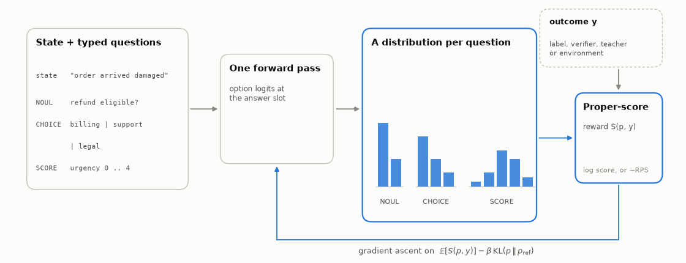

# The idea, and the sceptic's reading

Part of [open-rlcd](../README.md). This page explains what RLCD is as described, the estimator at its core, and
the question the experiments are built to answer. The results are in [results.md](results.md) and
[toy.md](toy.md).

## What is RLCD?

RLCD is reinforcement learning whose reward is a **proper scoring rule applied to the model's stated
distribution over typed options**, judged against an outcome supplied by labels, a verifier, a teacher model or
an environment:

$$
\max_\theta\; \mathbb{E}_{s,\,q,\; y}\Big[\, S\big(p_\theta(\cdot\mid s,q),\, y\big) \Big] \;-\; \beta\,\mathrm{KL}\big(p_{\text{ref}} \,\|\, p_\theta\big)
$$

A question is *typed*: `NOUL` (true or false), `CHOICE` (one of several unordered options) or `SCORE` (an
ordered scale). The model gives a probability for every option in one forward pass. $S$ is the log score for
`NOUL` and `CHOICE`, and the negative ranked probability score (RPS) for `SCORE`. The penalty is the
*forward* KL, the direction decider's retention term uses. It is large when the policy puts little mass on an
option the reference supports, so it penalises collapse onto one option and partly counteracts RLVR's
overconfidence; one exploratory run without it will show by how much ([`docs/decisions.md`](decisions.md) D1).

  <picture>
    <source media="(prefers-color-scheme: dark)" srcset="../figures/concept-dark.png">
    
  </picture>

**The contrast case is RLVR**, where the reward is $\mathbb{1}[a=y]$ for a sampled answer $a\sim p_\theta$.
Its expected value, $\sum_a p(a)\,q(a)$, is maximised by putting all the probability on the most likely answer.
It is an *improper* score, so it pushes the model to be sharper than the outcomes justify.

**Bandit form.** Sometimes only the sampled answer can be checked. With reward
$r = \mathbb{1}[a=y]/p_\theta(a)$ (stop-gradient on the denominator), REINFORCE is an unbiased estimator of
$\nabla\log p_\theta(y)$:

$$
\mathbb{E}_{a\sim p}\Big[\tfrac{\mathbb{1}[a=y]}{p(a)}\,\nabla\log p(a)\Big] \;=\; \sum_a p(a)\,\tfrac{\mathbb{1}[a=y]}{p(a)}\,\nabla\log p(a) \;=\; \nabla\log p(y).
$$

[`tests/test_estimators.py`](../tests/test_estimators.py) checks this by exact enumeration, by Monte Carlo, and by
showing the same check *rejects* RLVR. Clipping the weight trades that unbiasedness for lower variance; the
tests pin the bias exactly (`min(1, c·p_y)` times the true gradient).

**When is RL needed at all?** With fixed labels, the full-distribution RLCD objective has the same gradient as
supervised log loss. RL is necessary only when (a) feedback is bandit-only, or (b) outcomes depend on the
model's own actions (on-policy environments). The experiments are built around that claim: Exp A tests the
label setting, Exp B the on-policy one.

## Is RLCD just a data engine?

A sceptic can read RLCD as a **branded proper-scoring fine-tune, with at most a data loop around it, and no RL in
it**. This repo tests that reading in three places instead of arguing about it:

- **The main test, Exp A: A2 against the RL arms.** A2 is "train normally, calibrate afterwards": continue the start
  model with plain log loss (RPS for `SCORE`), then fit one temperature per answer type. If the cynical reading is
  right, A2 should match the RL arms (A3 RLVR, A4 RLCD-bandit, A5 RLCD-full) once those are temperature-scaled too.
  That is pre-registered hypothesis **H5**, with **H5b** checking the per-domain calibration and resolution that
  pooled ECE can hide (Exp 0b).
- **Does mining add anything? A6 against A6r.** No new data is generated. The training pool is split in half by
  hash. **A6** starts on half A and, over four rounds, mines the questions the current model is least sure about
  from half B (labels stay hidden until after selection), fine-tuning with plain log loss; **A6r** selects from the
  same half B at random with the same per-type quotas. Both get the same total optimiser steps as every other arm
  (a quarter per round, continuing from the previous round's weights). Because both only choose among data already
  in the pool, A6 against A6r tests the *selection rule*, not data volume (**H4**).
- **Exp B, B4 ("cynical")**: take B1's final policy, fit the belief heads by supervised log loss on that
  policy's rollouts, then temperature-scale. B3 trains the beliefs jointly and on-policy (**H7**).

**Result** (details in [results.md](results.md)). *Exp A:* on the pre-registered dev set, the supervised control plus temperature scaling is
within noise of the RL arms, and A6 is not shown to beat A6r after the pre-registered correction; the equivalence that H5
asked for was **not established** at its margin, and RLVR's overconfidence is real but small with the KL anchor and
large without it. *Exp B:* **H7 holds** by the pre-registered rule (B3's beliefs beat B4's after temperature scaling at a
matched game score), but a supervised fit alone (B4 without temperature scaling) is nearly as good, B4 is better than B3
in two of three seeds, and B3 plays below B1 on average. The honest summary is that **RLCD is more than a relabelled
fine-tune only in the narrow sense that joint on-policy training did no worse than the best supervised version, and
not clearly better.**
