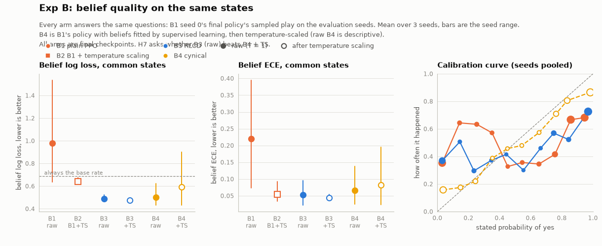
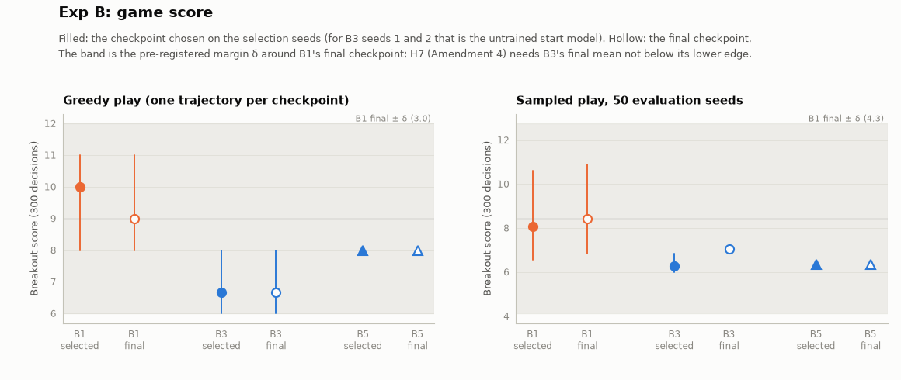
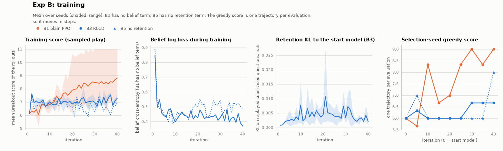

# Exp A and Exp B: results

Part of [open-rlcd](../README.md). Everything on this page is generated from `results/*.json` (`make readme`); the
pre-registration is [`PREREGISTRATION.md`](../PREREGISTRATION.md) and the decisions behind it are in
[decisions.md](decisions.md). Exp A is a 9B language model trained with teacher labels; Exp B is Breakout.

## Exp A results: a 9B decider with teacher labels

Setup (all frozen in [`PREREGISTRATION.md`](../PREREGISTRATION.md) before the runs): the Qwen3.5-9B decider after its
supervised stage is trained further for 734 steps on typed questions (`NOUL`, `CHOICE`, `SCORE`) written by a teacher
model, with LoRA, one shared learning rate, a forward-KL anchor to the start model and three seeds per arm. The arms
differ only in the loss: **A1** supervised log loss (ranked probability score for `SCORE`), **A2** = A1 plus one
temperature per answer type, **A3** RLVR, **A4** RLCD-bandit, **A5** RLCD-full through the RL code path, **A6** mining by
predictive entropy over a held-back half of the pool, **A6r** the same with random selection. The test set is an
independent dev set of four unseen domains; temperatures are fitted on a separate calibration split. Every test below
is a paired bootstrap over items with Holm correction and equivalence margins set from the A1 seed spread.

<!-- BEGIN gen:expA_headline -->
On the independent dev set, continued training from the start model takes log loss from 0.446 to between 0.262 and 0.288 and accuracy from 0.808 to between 0.889 and 0.897, whatever the arm. RLVR (A3) ends with an ECE of 0.030 against 0.015 for the supervised control (difference +0.0148, 95% interval +0.0046 to +0.0197) at the same accuracy, and without a worse log loss (difference -0.0018, 95% interval -0.0129 to +0.0099). After one temperature per answer type the ECEs are 0.021 (A3) and 0.019 (A1).
<!-- END gen:expA_headline -->

### Hypotheses, as pre-registered

<!-- BEGIN gen:expA_verdicts -->
| hypothesis (pre-registered) | what the dev set shows | verdict | same test, seed-ensembled | same test, selection split (exploratory) |
|---|---|---|---|---|
| **H1** A3 (RLVR) has higher ECE and log loss than A1, accuracy within ±δ | ECE +0.0148 (+0.0046 to +0.0197), log loss -0.0018 (-0.0129 to +0.0099); C1-acc passed | **does not hold** | does not hold | does not hold |
| **H2** A5 matches A1 on every metric | C2-log_loss passed, C2-ece passed, C2-acc passed, C2-brier passed, C2-reliability passed, C2-resolution passed | **holds** | holds | does not hold |
| **H3** A4 reaches A1's calibration | ECE +0.0052 (-0.0033 to +0.0094), log loss -0.0120 (-0.0212 to -0.0023); C3-ece passed, C3-log_loss passed | **holds** | does not hold | does not hold |
| **H4** A6 is no better than A6r | ECE -0.0057 (-0.0099 to +0.0010), log loss -0.0091 (-0.0173 to -0.0018), accuracy +0.0044 (-0.0002 to +0.0094); none passed after Holm | **holds** | holds | does not hold |
| **H5** with TS, A1 is within noise of every RL arm on ECE | C5-a3 did not pass, C5-a4 did not pass, C5-a5 did not pass (margin 0.0083) | **does not hold** | does not hold | does not hold |
| **H5b** with TS, A3 has worse per-domain ECE and lower resolution than A1 | per-domain ECE +0.0031 (-0.0045 to +0.0087), resolution +0.0019 (-0.0041 to +0.0079) | **does not hold** | does not hold | holds |
<!-- END gen:expA_verdicts -->

"Does not hold" for an equivalence hypothesis (H2, H3, H5) means the interval was not inside the margin, not that the
arms differ. The last two columns are robustness checks (the same tests on seed-averaged probabilities, and on the
selection split, which is *not* the test set) and are exploratory.

  <picture>
    <source media="(prefers-color-scheme: dark)" srcset="../figures/expA_overview-dark.png">
    
  </picture>

### Dev set (the pre-registered test set)

<!-- BEGIN gen:expA_dev -->
| arm | log loss | accuracy | ECE | ECE after TS | log loss after TS |
|---|---|---|---|---|---|
| A0 start model, T = 1 | [0.446](../results/expA/analysis.json) | [0.808](../results/expA/analysis.json) | [0.045](../results/expA/analysis.json) | [0.021](../results/expA/analysis.json) | [0.430](../results/expA/analysis.json) |
| A0 as served, T = 1.05 | [0.443](../results/expA/analysis.json) | [0.808](../results/expA/analysis.json) | [0.044](../results/expA/analysis.json) | | |
| A1 supervised (= A2 after TS) | [0.274 (0.265–0.283)](../results/expA/analysis.json) | [0.893 (0.890–0.897)](../results/expA/analysis.json) | **[0.015 (0.014–0.017)](../results/expA/analysis.json)** | [0.019 (0.016–0.023)](../results/expA/analysis.json) | [0.269 (0.259–0.280)](../results/expA/analysis.json) |
| A3 RLVR | **[0.273 (0.261–0.279)](../results/expA/analysis.json)** | [0.897 (0.895–0.901)](../results/expA/analysis.json) | [0.030 (0.024–0.034)](../results/expA/analysis.json) | [0.021 (0.018–0.023)](../results/expA/analysis.json) | [0.268 (0.259–0.274)](../results/expA/analysis.json) |
| A4 RLCD-bandit | **[0.262 (0.257–0.268)](../results/expA/analysis.json)** | [0.895 (0.893–0.896)](../results/expA/analysis.json) | [0.021 (0.017–0.028)](../results/expA/analysis.json) | [0.023 (0.020–0.026)](../results/expA/analysis.json) | [0.266 (0.259–0.274)](../results/expA/analysis.json) |
| A5 RLCD-full | [0.282](../results/expA/analysis.json) | [0.895](../results/expA/analysis.json) | **[0.017](../results/expA/analysis.json)** | [0.019](../results/expA/analysis.json) | [0.275](../results/expA/analysis.json) |
| A6 mined | [0.279 (0.276–0.282)](../results/expA/analysis.json) | [0.893 (0.890–0.896)](../results/expA/analysis.json) | **[0.016 (0.014–0.018)](../results/expA/analysis.json)** | [0.020 (0.018–0.021)](../results/expA/analysis.json) | [0.273 (0.271–0.276)](../results/expA/analysis.json) |
| A6r random | [0.288 (0.286–0.291)](../results/expA/analysis.json) | [0.889 (0.885–0.893)](../results/expA/analysis.json) | [0.022 (0.017–0.026)](../results/expA/analysis.json) | [0.026 (0.021–0.031)](../results/expA/analysis.json) | [0.280 (0.278–0.283)](../results/expA/analysis.json) |
| A3 with β = 0 (exploratory, 1 run) | [1.488](../results/expA/analysis.json) | [0.874](../results/expA/analysis.json) | [0.112](../results/expA/analysis.json) | [0.107](../results/expA/analysis.json) | [0.410](../results/expA/analysis.json) |
<!-- END gen:expA_dev -->

Seed mean (min&ndash;max over 3 seeds; A5, A0 and the &beta; = 0 run are single runs). Bold: best, or within the best
arm's seed range. "After TS" fits one temperature per answer type on the calibration split. A1 *is* A2 in the
"after TS" columns.

### The 19 pre-registered tests

<!-- BEGIN gen:expA_tests -->
| test | comparison (row) | difference A − B (95% interval) | margin δ | Holm p | passed |
|---|---|---|---|---|---|
| C1-ece | a3 vs a1 (raw), A higher | +0.0148 (+0.0046 to +0.0197) | – | 0.016 | yes |
| C1-log_loss | a3 vs a1 (raw), A higher | -0.0018 (-0.0129 to +0.0099) | – | 1.000 | no |
| C1-acc | a3 vs a1 (raw), equivalent | +0.0042 (-0.0017 to +0.0099) | 0.0219 | <0.001 | yes |
| C2-log_loss | a5 seed 0 vs a1 seed 0 (raw), equivalent | -0.0007 (-0.0116 to +0.0108) | 0.0325 | <0.001 | yes |
| C2-ece | a5 seed 0 vs a1 seed 0 (raw), equivalent | +0.0001 (-0.0100 to +0.0082) | 0.0178 | 0.009 | yes |
| C2-acc | a5 seed 0 vs a1 seed 0 (raw), equivalent | +0.0047 (-0.0029 to +0.0125) | 0.0219 | <0.001 | yes |
| C2-brier | a5 seed 0 vs a1 seed 0 (raw), equivalent | -0.0011 (-0.0080 to +0.0064) | 0.0191 | <0.001 | yes |
| C2-reliability | a5 seed 0 vs a1 seed 0 (raw), equivalent | -0.0007 (-0.0042 to +0.0027) | 0.0094 | <0.001 | yes |
| C2-resolution | a5 seed 0 vs a1 seed 0 (raw), equivalent | +0.0004 (-0.0073 to +0.0075) | 0.0278 | <0.001 | yes |
| C3-ece | a4 vs a1 (raw), equivalent | +0.0052 (-0.0033 to +0.0094) | 0.0178 | <0.001 | yes |
| C3-log_loss | a4 vs a1 (raw), equivalent | -0.0120 (-0.0212 to -0.0023) | 0.0325 | <0.001 | yes |
| C4-ece | a6 vs a6r (raw), A lower | -0.0057 (-0.0099 to +0.0010) | – | 0.315 | no |
| C4-log_loss | a6 vs a6r (raw), A lower | -0.0091 (-0.0173 to -0.0018) | – | 0.091 | no |
| C4-acc | a6 vs a6r (raw), A higher | +0.0044 (-0.0002 to +0.0094) | – | 0.300 | no |
| C5-a3 | a3 vs a1 (ts), equivalent | +0.0024 (-0.0058 to +0.0089) | 0.0083 | 0.300 | no |
| C5-a4 | a4 vs a1 (ts), equivalent | +0.0039 (-0.0022 to +0.0078) | 0.0083 | 0.198 | no |
| C5-a5 | a5 seed 0 vs a1 seed 0 (ts), equivalent | -0.0043 (-0.0109 to +0.0057) | 0.0083 | 0.384 | no |
| H5b-domain_ece | a3 vs a1 (ts), A higher | +0.0031 (-0.0045 to +0.0087) | – | 0.944 | no |
| H5b-resolution | a3 vs a1 (ts), A lower | +0.0019 (-0.0041 to +0.0079) | – | 1.000 | no |
<!-- END gen:expA_tests -->

  <picture>
    <source media="(prefers-color-scheme: dark)" srcset="../figures/expA_tests-dark.png">
    
  </picture>

### By answer type, and why the pooled log loss needs care

<!-- BEGIN gen:expA_pertype -->
| arm | NOUL log loss | NOUL ECE | CHOICE log loss | CHOICE ECE | SCORE log loss | SCORE ECE |
|---|---|---|---|---|---|---|
| A0 start model | [0.491](../results/expA/analysis.json) | [0.112](../results/expA/analysis.json) | [0.333](../results/expA/analysis.json) | [0.029](../results/expA/analysis.json) | [0.644](../results/expA/analysis.json) | [0.058](../results/expA/analysis.json) |
| A1 supervised | [0.235 (0.227–0.239)](../results/expA/analysis.json) | [0.027 (0.025–0.030)](../results/expA/analysis.json) | [0.181 (0.159–0.192)](../results/expA/analysis.json) | [0.025 (0.022–0.027)](../results/expA/analysis.json) | [0.542 (0.531–0.554)](../results/expA/analysis.json) | [0.079 (0.076–0.082)](../results/expA/analysis.json) |
| A3 RLVR | [0.248 (0.242–0.251)](../results/expA/analysis.json) | [0.042 (0.039–0.046)](../results/expA/analysis.json) | [0.193 (0.178–0.205)](../results/expA/analysis.json) | [0.029 (0.023–0.032)](../results/expA/analysis.json) | [0.487 (0.475–0.504)](../results/expA/analysis.json) | [0.043 (0.042–0.046)](../results/expA/analysis.json) |
| A4 RLCD-bandit | [0.235 (0.227–0.249)](../results/expA/analysis.json) | [0.026 (0.024–0.029)](../results/expA/analysis.json) | [0.190 (0.176–0.210)](../results/expA/analysis.json) | [0.025 (0.020–0.033)](../results/expA/analysis.json) | [0.465 (0.454–0.484)](../results/expA/analysis.json) | [0.037 (0.034–0.038)](../results/expA/analysis.json) |
| A5 RLCD-full | [0.241](../results/expA/analysis.json) | [0.027](../results/expA/analysis.json) | [0.194](../results/expA/analysis.json) | [0.027](../results/expA/analysis.json) | [0.540](../results/expA/analysis.json) | [0.083](../results/expA/analysis.json) |
| A6 mined | [0.239 (0.234–0.245)](../results/expA/analysis.json) | [0.029 (0.026–0.034)](../results/expA/analysis.json) | [0.190 (0.178–0.198)](../results/expA/analysis.json) | [0.025 (0.024–0.026)](../results/expA/analysis.json) | [0.535 (0.527–0.543)](../results/expA/analysis.json) | [0.075 (0.073–0.077)](../results/expA/analysis.json) |
| A6r random | [0.254 (0.239–0.274)](../results/expA/analysis.json) | [0.040 (0.035–0.051)](../results/expA/analysis.json) | [0.199 (0.193–0.207)](../results/expA/analysis.json) | [0.026 (0.025–0.027)](../results/expA/analysis.json) | [0.538 (0.529–0.546)](../results/expA/analysis.json) | [0.087 (0.082–0.099)](../results/expA/analysis.json) |
<!-- END gen:expA_pertype -->

A1, A5, A6 and A6r train `SCORE` questions with the ranked probability score (a design decision, D3); A3 and A4 train
them from sampled answers. So the pooled log loss compares different `SCORE` objectives, and an arm can win it for that
reason alone. The like-for-like comparison is `NOUL` and `CHOICE`, where the arms train on the same kind of target.

  <picture>
    <source media="(prefers-color-scheme: dark)" srcset="../figures/expA_pertype_dev-dark.png">
    
  </picture>

### Temperatures fitted on the calibration split

<!-- BEGIN gen:expA_temps -->
| arm | NOUL | CHOICE | SCORE |
|---|---|---|---|
| A0 start model | 2.34 | 1.43 | 1.02 |
| A1 supervised | 0.97 (0.89–1.10) | 0.95 (0.93–0.97) | 0.75 (0.73–0.76) |
| A3 RLVR | 1.46 (1.42–1.51) | 1.17 (1.16–1.18) | 1.22 (1.14–1.35) |
| A4 RLCD-bandit | 0.97 (0.93–1.00) | 0.88 (0.87–0.89) | 1.10 (1.06–1.15) |
| A5 RLCD-full | 0.98 | 1.00 | 0.74 |
| A6 mined | 1.03 (1.02–1.06) | 1.06 (1.03–1.10) | 0.77 (0.74–0.81) |
| A6r random | 1.05 (1.00–1.08) | 1.03 (1.00–1.05) | 0.73 (0.71–0.75) |
| A3 with β = 0 | 20.00 | 12.79 | 10.69 |
<!-- END gen:expA_temps -->

A temperature above 1 means the arm was over-confident on the calibration split, below 1 under-confident. The start model
is over-confident; supervised training removes most of it (the `SCORE` rows, trained with the ranked probability score,
end under-confident); RLVR keeps some. 20 is the upper limit of the search.

### On the selection split (exploratory)

The selection split is drawn from the training distribution and is harder than the dev set (the start model scores far
lower on it). It was used for learning rates and checkpoints and so was *not* a pre-registered test set, but it is where the
two kinds of arm separate most.

<!-- BEGIN gen:expA_select -->
| arm | log loss | accuracy | ECE | ECE after TS | log loss after TS |
|---|---|---|---|---|---|
| A0 start model, T = 1 | [0.699](../results/expA/analysis.json) | [0.688](../results/expA/analysis.json) | [0.076](../results/expA/analysis.json) | [0.032](../results/expA/analysis.json) | [0.647](../results/expA/analysis.json) |
| A0 as served, T = 1.05 | [0.692](../results/expA/analysis.json) | [0.688](../results/expA/analysis.json) | [0.070](../results/expA/analysis.json) | | |
| A1 supervised (= A2 after TS) | **[0.346 (0.340–0.358)](../results/expA/analysis.json)** | [0.855 (0.848–0.859)](../results/expA/analysis.json) | **[0.027 (0.019–0.034)](../results/expA/analysis.json)** | [0.024 (0.022–0.027)](../results/expA/analysis.json) | [0.341 (0.335–0.352)](../results/expA/analysis.json) |
| A3 RLVR | [0.415 (0.402–0.422)](../results/expA/analysis.json) | [0.839 (0.835–0.842)](../results/expA/analysis.json) | [0.058 (0.055–0.061)](../results/expA/analysis.json) | [0.036 (0.030–0.039)](../results/expA/analysis.json) | [0.402 (0.391–0.409)](../results/expA/analysis.json) |
| A4 RLCD-bandit | **[0.348 (0.340–0.354)](../results/expA/analysis.json)** | [0.849 (0.848–0.849)](../results/expA/analysis.json) | **[0.026 (0.020–0.031)](../results/expA/analysis.json)** | [0.024 (0.019–0.027)](../results/expA/analysis.json) | [0.347 (0.340–0.353)](../results/expA/analysis.json) |
| A5 RLCD-full | **[0.346](../results/expA/analysis.json)** | [0.864](../results/expA/analysis.json) | **[0.027](../results/expA/analysis.json)** | [0.025](../results/expA/analysis.json) | [0.341](../results/expA/analysis.json) |
| A6 mined | **[0.352 (0.343–0.359)](../results/expA/analysis.json)** | [0.850 (0.843–0.861)](../results/expA/analysis.json) | [0.037 (0.030–0.043)](../results/expA/analysis.json) | [0.035 (0.024–0.043)](../results/expA/analysis.json) | [0.348 (0.339–0.355)](../results/expA/analysis.json) |
| A6r random | [0.375 (0.362–0.384)](../results/expA/analysis.json) | [0.844 (0.838–0.855)](../results/expA/analysis.json) | **[0.035 (0.028–0.041)](../results/expA/analysis.json)** | [0.037 (0.030–0.043)](../results/expA/analysis.json) | [0.369 (0.356–0.378)](../results/expA/analysis.json) |
| A3 with β = 0 (exploratory, 1 run) | [4.526](../results/expA/analysis.json) | [0.734](../results/expA/analysis.json) | [0.253](../results/expA/analysis.json) | [0.059](../results/expA/analysis.json) | [0.700](../results/expA/analysis.json) |
<!-- END gen:expA_select -->

### JevBench (descriptive)

Each adapter is merged into the start model and served by decider at T = 1.0 (one temperature for every answer type,
not the per-type temperatures of the "after TS" rows), then run through JevBench's public tiers. The hard tier has 111
items, so its standard error on accuracy is about four points: **accuracy does not separate the arms.**

<!-- BEGIN gen:expA_jev -->
| model | hard accuracy | hard Brier | hard ECE | easy accuracy | original accuracy |
|---|---|---|---|---|---|
| A0 start model | [0.685](../results/expA/jevbench.json) | [0.429](../results/expA/jevbench.json) | [0.113](../results/expA/jevbench.json) | [1.000](../results/expA/jevbench.json) | [0.972](../results/expA/jevbench.json) |
| A1 supervised | [0.706 (0.676–0.730)](../results/expA/jevbench.json) | [0.409 (0.375–0.435)](../results/expA/jevbench.json) | [0.144 (0.135–0.157)](../results/expA/jevbench.json) | [1.000 (1.000–1.000)](../results/expA/jevbench.json) | [0.968 (0.944–0.986)](../results/expA/jevbench.json) |
| A3 RLVR | [0.694 (0.676–0.703)](../results/expA/jevbench.json) | [0.470 (0.456–0.478)](../results/expA/jevbench.json) | [0.197 (0.182–0.209)](../results/expA/jevbench.json) | [1.000 (1.000–1.000)](../results/expA/jevbench.json) | [0.968 (0.958–0.972)](../results/expA/jevbench.json) |
| A4 RLCD-bandit | [0.682 (0.658–0.694)](../results/expA/jevbench.json) | [0.431 (0.416–0.447)](../results/expA/jevbench.json) | [0.166 (0.146–0.181)](../results/expA/jevbench.json) | [1.000 (1.000–1.000)](../results/expA/jevbench.json) | [0.972 (0.972–0.972)](../results/expA/jevbench.json) |
| A5 RLCD-full | [0.712](../results/expA/jevbench.json) | [0.388](../results/expA/jevbench.json) | [0.168](../results/expA/jevbench.json) | [1.000](../results/expA/jevbench.json) | [0.972](../results/expA/jevbench.json) |
| A6 mined | [0.700 (0.685–0.721)](../results/expA/jevbench.json) | [0.407 (0.402–0.418)](../results/expA/jevbench.json) | [0.146 (0.127–0.160)](../results/expA/jevbench.json) | [1.000 (1.000–1.000)](../results/expA/jevbench.json) | [0.968 (0.958–0.972)](../results/expA/jevbench.json) |
| A6r random | [0.703 (0.694–0.721)](../results/expA/jevbench.json) | [0.427 (0.403–0.451)](../results/expA/jevbench.json) | [0.161 (0.149–0.172)](../results/expA/jevbench.json) | [1.000 (1.000–1.000)](../results/expA/jevbench.json) | [0.968 (0.958–0.972)](../results/expA/jevbench.json) |
| A3 with β = 0 (exploratory) | [0.703](../results/expA/jevbench.json) | [0.580](../results/expA/jevbench.json) | [0.290](../results/expA/jevbench.json) | [1.000](../results/expA/jevbench.json) | [0.958](../results/expA/jevbench.json) |
<!-- END gen:expA_jev -->

Seed mean (min&ndash;max); A5, A0 and the &beta; = 0 run are single runs. No JevBench item is used for training or for
choosing training data.

On the hard tier the ECE of every trained arm is higher than the start model's even though accuracy is the same or
slightly higher; the Brier score is mixed (lower for some arms, higher for RLVR). RLVR is the worst of the anchored arms
on both, and the run without the KL penalty is far worse. This is one 111-item tier and a different distribution from the teacher-written dev set, so it is a pointer, not a
test; the pre-registered tests do not use JevBench.

### Exploratory: RLVR without the KL anchor (E1)

  <picture>
    <source media="(prefers-color-scheme: dark)" srcset="../figures/expA_beta0-dark.png">
    
  </picture>

With the forward-KL penalty removed, RLVR keeps most of its accuracy and loses its probabilities: the confidences are far
too sharp and no single temperature repairs them (the fitted temperature reaches the search bound for `NOUL`). This is
one run. It supports the reading that the anchor, not the reward, is what keeps RLVR's overconfidence modest in the
anchored runs.

### What Exp A does and does not show

- **For the sceptical reading.** On the dev set, the arms are close after temperature scaling, A5 reproduces A1 (as it
  must), and mining (A6) is not shown to beat random selection (A6r) once the pre-registered correction is applied.
- **Against it.** RLVR (A3) has a clearly worse ECE than the supervised control before temperature scaling, and on the
  harder in-distribution split it is worse on log loss, ECE and per-domain ECE even after scaling, with slightly lower
  accuracy. So RLVR's overconfidence is real in this setting; it is small on the dev set and temperature scaling removes
  most of it there.
- **Not shown.** The pre-registered equivalence of H5 (margin set from two A1 seeds on a 1,189-question split) could not be
  established: the intervals were wider than the margin, so "no difference found" is not "equivalent". Neither H1 nor
  H5b was met as stated.
- **No claim about RLCD in general.** One model, one teacher-written dataset, one learning rate shared across arms (RLVR is
  not at its own best), a forward-KL anchor that already limits RLVR, and an independent dev set written by the same
  teacher as the training data.

## Exp B results: Breakout, where the outcomes depend on the model's own moves

Setup (frozen in [`PREREGISTRATION.md`](../PREREGISTRATION.md), Amendment 2, before any Exp B run): the decider after its
supervised stage plays Atari Breakout from four RAM readings written as text, choosing among four moves. **B1** is plain
PPO. **B3** adds, to the same loop, belief questions about what happens next ("will a brick break in the next 30 moves",
"will a life be lost", "will the paddle return the ball"), scored with the log score against what happened, and a
retention term that keeps the model close to its start on replayed supervised questions (loss weights actor : belief :
retention = 1 : 2 : 7; B1 is 1 : 0 : 0). **B5** is B3 without retention (one seed). **B4** is the sceptic's version: B1's
final policy with its belief answers fitted by plain supervised learning on B1's own rollouts and then temperature-scaled.

**H7**: B3's beliefs beat B4's on the *same* states at a matched game score. Every arm answers exactly the questions that
one frozen policy (B1 seed 0, final checkpoint) meets on the evaluation seeds, so a different state distribution cannot
confound the comparison.

<!-- BEGIN gen:expB_h7 -->
| quantity | value |
|---|---|
| belief log loss on the common states, B3 (final checkpoint, T = 1) | [0.488 (0.467–0.524)](../results/expB/analysis.json) |
| belief log loss on the common states, B4 (after temperature scaling) | [0.592 (0.432–0.900)](../results/expB/analysis.json) |
| B3 − B4, paired bootstrap over 3,513 questions | -0.1042 (95% interval -0.1168 to -0.0919) |
| **belief condition**: interval below 0 | **met** |
| greedy score on the evaluation seeds, B1 / B3 | [9.00 (8.00–11.00)](../results/expB/analysis.json) / [6.67 (6.00–8.00)](../results/expB/analysis.json) |
| δ_game (range of B1's seeds on the selection seeds, floored at 5% of their mean) | 3.00 |
| **game condition**: B3's score not below B1's by more than δ_game | **met** |
| **H7** (final checkpoints, Amendment 4) | **holds** |
<!-- END gen:expB_h7 -->

**By the pre-registered rule, H7 holds. It is a fragile result, and the rest of this section is about why.**

  <picture>
    <source media="(prefers-color-scheme: dark)" srcset="../figures/expB_beliefs-dark.png">
    
  </picture>

### Belief quality on the common states

<!-- BEGIN gen:expB_beliefs -->
| arm (answers to the common-state questions) | log loss | Brier | ECE | accuracy | skill vs base rate |
|---|---|---|---|---|---|
| B1 plain PPO, T = 1 | [0.979 (0.635–1.536)](../results/expB/analysis.json) | [0.579 (0.438–0.787)](../results/expB/analysis.json) | [0.221 (0.074–0.395)](../results/expB/analysis.json) | [0.605 (0.540–0.646)](../results/expB/analysis.json) | [-0.419 (-1.226–0.081)](../results/expB/analysis.json) |
| B2 = B1 after temperature scaling | [0.640 (0.618–0.675)](../results/expB/analysis.json) | [0.450 (0.429–0.482)](../results/expB/analysis.json) | [0.055 (0.034–0.093)](../results/expB/analysis.json) | [0.605 (0.540–0.646)](../results/expB/analysis.json) | [0.072 (0.022–0.105)](../results/expB/analysis.json) |
| B3 RLCD, T = 1 | [0.488 (0.467–0.524)](../results/expB/analysis.json) | [0.314 (0.303–0.331)](../results/expB/analysis.json) | [0.053 (0.022–0.095)](../results/expB/analysis.json) | [0.787 (0.785–0.787)](../results/expB/analysis.json) | [0.293 (0.241–0.323)](../results/expB/analysis.json) |
| B3 after temperature scaling | [0.477 (0.466–0.489)](../results/expB/analysis.json) | [0.310 (0.302–0.317)](../results/expB/analysis.json) | [0.044 (0.036–0.055)](../results/expB/analysis.json) | [0.787 (0.785–0.787)](../results/expB/analysis.json) | [0.309 (0.292–0.325)](../results/expB/analysis.json) |
| B4 cynical: supervised fit, then temperature scaling | [0.592 (0.432–0.900)](../results/expB/analysis.json) | [0.334 (0.279–0.433)](../results/expB/analysis.json) | [0.082 (0.023–0.195)](../results/expB/analysis.json) | [0.783 (0.748–0.809)](../results/expB/analysis.json) | [0.142 (-0.305–0.374)](../results/expB/analysis.json) |
| B4 supervised fit, T = 1 (descriptive) | [0.500 (0.431–0.624)](../results/expB/analysis.json) | [0.320 (0.279–0.389)](../results/expB/analysis.json) | [0.067 (0.025–0.137)](../results/expB/analysis.json) | [0.783 (0.748–0.809)](../results/expB/analysis.json) | [0.275 (0.096–0.376)](../results/expB/analysis.json) |
| B5 no retention (1 seed), T = 1 | [0.459](../results/expB/analysis.json) | [0.297](../results/expB/analysis.json) | [0.027](../results/expB/analysis.json) | [0.790](../results/expB/analysis.json) | [0.335](../results/expB/analysis.json) |
<!-- END gen:expB_beliefs -->

All arms are final checkpoints (iteration 40), seed mean (min&ndash;max over 3 seeds; B5 is one seed). Skill is
1 &minus; log loss / the log loss of always saying the base rate. B1's beliefs are *worse* than the base rate before temperature
scaling, as they were at the start.

### How strong is the H7 result?

<!-- BEGIN gen:expB_compare -->
| comparison, belief log loss on the common states (lower is better for the first arm) | questions bootstrap | episodes bootstrap |
|---|---|---|
| **B3 − B4 after TS (pre-registered H7)** | **-0.1042 (-0.1168 to -0.0919)** | -0.1042 (-0.1204 to -0.0881) |
| B3 − B4 without temperature scaling (descriptive) | -0.0125 (-0.0206 to -0.0049) | -0.0125 (-0.0211 to -0.0045) |
| B3 + TS − B4 + TS (descriptive) | -0.1150 (-0.1282 to -0.1021) | |
| B3 − B1 (descriptive) | -0.4914 (-0.5287 to -0.4564) | |
| B3 − B2 = B1 after TS (descriptive) | -0.1524 (-0.1710 to -0.1324) | |
| *B3 selected checkpoint − B4 after TS (the pre-amendment rule; two of the three B3 selections are the start model)* | *+0.4600 (+0.4216 to +0.4993)* | *+0.4600 (+0.4158 to +0.5047)* |
<!-- END gen:expB_compare -->

<!-- BEGIN gen:expB_perseed -->
| seed | B3 (T = 1) | B3 after TS | B4 (T = 1) | B4 after TS |
|---|---|---|---|---|
| 0 | 0.467 | 0.466 | 0.446 | 0.444 |
| 1 | 0.524 | 0.489 | 0.431 | 0.432 |
| 2 | 0.472 | 0.477 | 0.624 | 0.900 |
<!-- END gen:expB_perseed -->

Three things qualify the headline.

1. **Most of B3's margin is B4's temperature step, and it comes from one seed.** Supervised learning on B1's own rollouts
   already repairs B1's beliefs (the B4 row without temperature scaling is close to B3), and B3's lead over that version is
   small. B4 loses to B3 on average mostly because, for seed 2, the temperature fitted on B1's selection-seed questions
   was far from the one the common states needed; for seeds 0 and 1 B4 is *better* than B3 in the per-seed table. The
   pre-registered test resamples questions, not seeds, so it cannot see this spread; with three seeds, the per-seed table is
   the honest picture. The reading that the data favour is: **joint on-policy training did not clearly beat a supervised
   fit on the policy's own rollouts**, which is the sceptic's claim.
2. **The common-state questions come from 50 episodes**, so questions are not independent. Resampling whole episodes
   widens the intervals only slightly here (second column above); the verdict does not change.
3. **The game-score condition is met because the margin is wide.** B1's seeds differ a lot (one learned to play much
   better than the other two), so the pre-registered margin &delta; is large, and B3 plays below B1 on average (below).

### Game score

<!-- BEGIN gen:expB_games -->
| arm | checkpoint | selected iteration (per seed) | greedy score | sampled score |
|---|---|---|---|---|
| B1 plain PPO | selected | 10, 25, 20 | [10.00 (8.00–11.00)](../results/expB/analysis.json) | [8.07 (6.56–10.62)](../results/expB/analysis.json) |
| B1 plain PPO | final | 40 | [9.00 (8.00–11.00)](../results/expB/analysis.json) | [8.43 (6.82–10.88)](../results/expB/analysis.json) |
| B3 RLCD | selected | 30, 0, 0 | [6.67 (6.00–8.00)](../results/expB/analysis.json) | [6.27 (6.00–6.82)](../results/expB/analysis.json) |
| B3 RLCD | final | 40 | [6.67 (6.00–8.00)](../results/expB/analysis.json) | [7.07 (6.98–7.22)](../results/expB/analysis.json) |
| B5 no retention (1 seed) | selected | 40 | [8.00](../results/expB/analysis.json) | [6.34](../results/expB/analysis.json) |
| B5 no retention (1 seed) | final | 40 | [8.00](../results/expB/analysis.json) | [6.34](../results/expB/analysis.json) |
<!-- END gen:expB_games -->

  <picture>
    <source media="(prefers-color-scheme: dark)" srcset="../figures/expB_games-dark.png">
    
  </picture>

The retention term keeps B3's greedy play close to the start model's, so B3 learns beliefs without learning to play much
better; B1, which has nothing holding it back, improves more (and varies much more between seeds). **Greedy play is
deterministic** (the same trajectory on every seed), so a "greedy score" is one number per checkpoint, which is why
Amendment 3 adds a sampled-play condition and why the greedy columns move in steps.

  <picture>
    <source media="(prefers-color-scheme: dark)" srcset="../figures/expB_training-dark.png">
    
  </picture>

### What changed along the way, and what that means for the verdict

- **The "selected checkpoint" was not informative.** Greedy play is one trajectory, so the selection criterion is one
  noisy number and, because ties keep the earlier checkpoint, B3's selected checkpoint is the **untrained start model** for
  two of its three seeds. Amendment 4 (written before any B3 evaluation file was opened) moves H7 to the final checkpoints.
  On the original rule (selected checkpoints) H7 would **not** hold, which the comparison table shows in italics. The
  amendment is a judgement call about which of two defensible readings of "the checkpoint" to use, made for a stated reason,
  not a way of reaching a verdict; both are reported.
- **B5 (no retention term, one seed)** is descriptive: it shows what the belief term does without the anchor.
- **Not tested here:** whether beliefs help on other games, other model sizes, or beliefs about the environment's rules
  rather than ball dynamics; and whether B3's beliefs help the policy (they were not used for acting).
